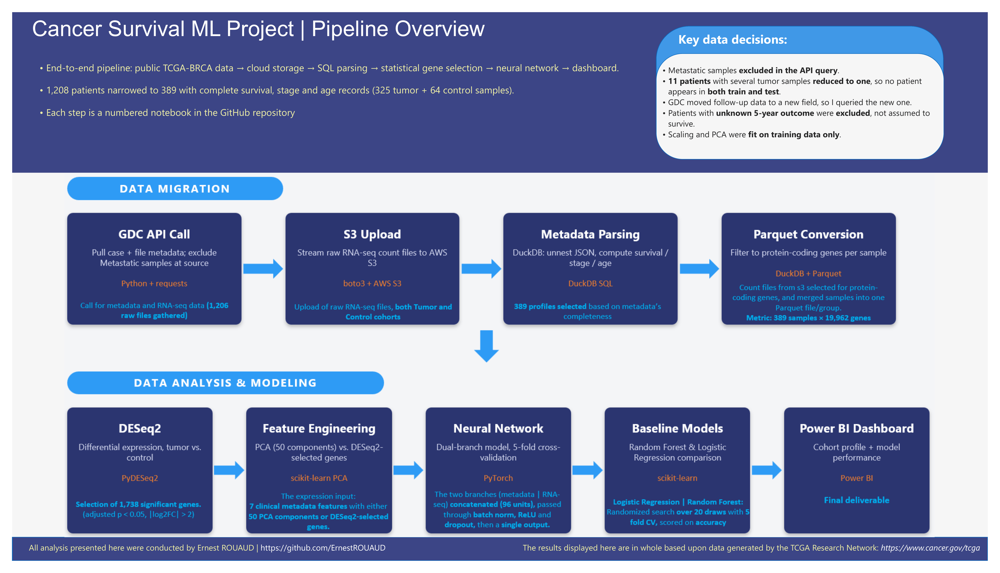
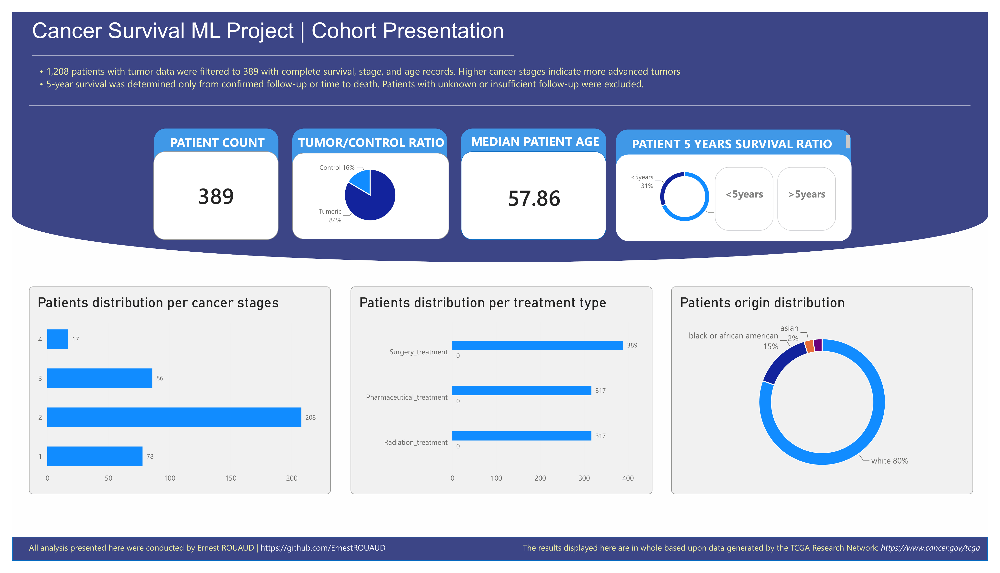
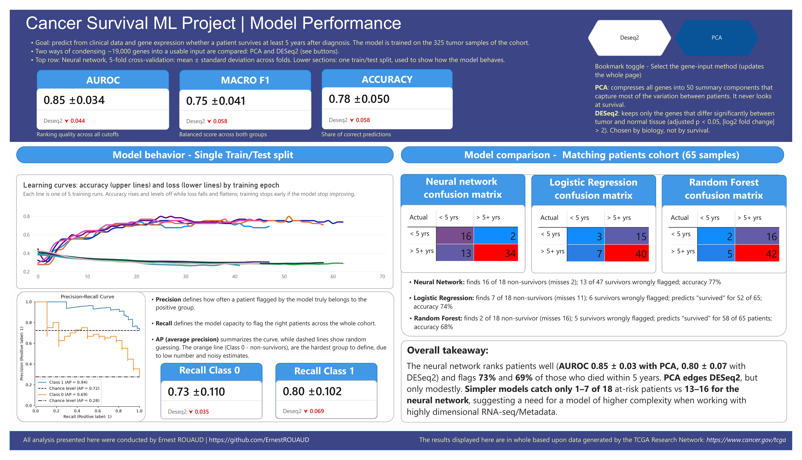
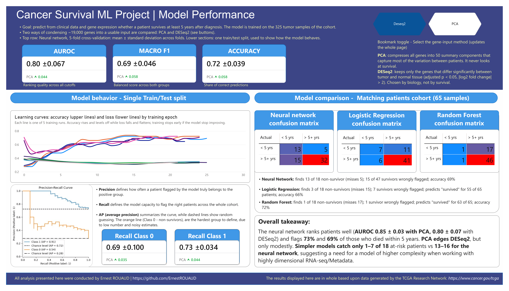

# __Cancer Survival ML Project__

The aim of this project is to try to predict the probability of __breast cancer__ patients to survive past a __5-years mark__, based on clinical and gene expression (_RNA-seq_) data.

The used data originated from [TCGA-BRCA database](https://www.cancer.gov/ccg/research/genome-sequencing/tcga), and was treated during a build end-to-end pipeline, spanning from public API to Power BI dashboard. 

<div align="center"></div>

## __Overview__:

- __Question__: Can you predict breast cancer __5 years surival__ after diagnosis based on __clinical features__ and __RNA-seq gene expression__?   
- __Data__: Open-access TCGA-BRCA data gathered using the GDC API. 1,206 RNA-seq files were narrowed to 389 samples (325 tumor + 64 matched normal) with complete survival, stage and age records. Models were trained on the 325 tumor samples.
- __Model__: A __dual-branch neural network__ (clinical branch + gene-expression branch), compared on two ways of reducing about 19,000 genes: __PCA__ (50 components) and __DESeq2__ (1,737 differentially expressed genes). Random forest and logistic regression serve as baselines.
    - _PCA_:  compresses all genes into 50 summary components that capture most of the variation between patients.
    - _Deseq2_: keeps only the genes that differ significantly between tumor and normal tissue (adjusted p < 0.05, |log2 fold change|> 2). The more biologically-relevant option.
- __Evaluation__: 5-fold stratified cross-validation for performance claims; one 80/20 split (260 train / 65 test patients) for curves and confusion matrices.
- __Main results__: Our dual-branch neural network reaches an __AUROC of 0.85 ± 0.03__ in 5-fold cross-validation

## __Dashboard__: 
###### (_A PDF export of all Power BI pages is present in dashboard/_)
####  __Cohort__:

<div align="center"></div>

####  __Model Performance__: 
(KPIs and Overall takeaways depicts different comparison between the two feature-selection methods)

#### __PCA__: 
<div align="center"></div>

#### __Deseq2__: 
<div align="center"></div>

## __Key Results__: 

### __Neural network, 5-fold cross-validation (mean ± std across folds)__

| Gene input | AUROC | Class 0 recall | Macro F1 | Accuracy| 
|:------------:|-------:|-----------------:|----------:|---------:|
|PCA (50 components)|0.848 ± 0.034|0.727 ± 0.110|0.746 ± 0.041|0.782 ± 0.050|
|DESeq2 genes (1,737)|0.804 ± 0.067|0.692 ± 0.100|0.687 ± 0.046|0.723 ± 0.039|

- _AUROC_ : Measures __how well the model ranks patients__, illustrating whether survivors get a higher predicted survival probability than non-survivors.

    - If you pick one survivor and one non-survivor at random, AUROC is the chance the model gives the survivor the higher score. 0.5 is a coin flip and 1.0 is perfect decision by the model.  

- _Class 0_ : Of all the patients who really died within 5 years, __how many were flagged as high-risk__. It equals correctly flagged ÷ all patients who died.

    - Missing an at-risk patient is the costliest error here, this is therefore the most valuable metric for this project. 

- _Macro F1_ : __Balances the model's precision__ (how many flagged patients truly belong to the group) and __recall__ (how many of the group were found). 

    - In a imbalanced dataset such as this one, the smaller group counts as much as the larger one, so a model that ignores the non-survivors get a lower score.

- _Accuracy_ : The share of __all patients classified correctly__.

##### &rarr; __PCA leads on every metric__, but the gaps are small compared with fold-to-fold variation, it is therefore more of a trend, than a statistical difference.

### __Neural network vs. baselines: one split, same 65 test patients (18 died within 5 years, 47 survived)__

| Model | 	PCA: non-survivors found | PCA: accuracy | DESeq2: non-survivors found | DESeq2: accuracy | 
|:------------:|-------:|-----------------:|----------:|---------:|
|Neural network|__16 of 18__|	77%|__13 of 18__|69%|
|Logistic Regression|3 of 18|	66%|	7 of 18|	74%|
|Random Forest|2 of 18|68%|	1 of 18|72%|

Accuracy alone is misleading here. In an hypothetical dataset where 7 out of 10 patients survive, a model putting everyone in the survivor group will have 70% accuracy per default. Our Neural Network, on the other hand, noticed far more patients who died early, which suggests the added complexity helps with this kind of question. 


| # | 	Notebook | 	goal | 
|:------------:|:-------|:-----------------|
|1|_1-API_call.ipynb_|Pulls case and file metadata from the GDC API; keeps primary tumor and normal samples; checks for duplicates and tumor/control overlap; exports the sample lists|
|2|_2-RNA_seq_dl.ipynb_|	Streams the raw RNA-seq count files from GDC into AWS S3|
|3|_3-json_metadata_parsing.ipynb_|DuckDB SQL unnests the case JSON; computes age, treatments, 5-year survival and cancer stage; filters to complete records (389 samples)|
|4|_4-RNA_parquet.ipynb_|Reads the selected count files from S3 through DuckDB, keeps protein-coding genes (19,962), writes one Parquet file per group|
|5|_5-Deseq2_gene_selection.ipynb_|Tumor vs. normal differential expression with PyDESeq2; keeps genes with 'adjusted p value' < 0.05 and \|log2 fold change\| > 2|
|6|_6-ML_model.ipynb_|Dual-branch neural network on both gene inputs; single-split evaluation and 5-fold cross-validation|
|7|_7-baseline_model.ipynb_|	Random forest and logistic regression baselines on the same inputs|

Reusable code lives in _src/: s3_utils.py_ (S3 transfer and Parquet conversion) and _ML_model.py_ (model classes and training loop).

## __Key data decisions__:
- Metastatic samples excluded in the API query, so every patient contributes a primary tumor sample.
- One tumor sample per patient. 11 patients had several primary tumor files and were reduced to one, so no patient can appear in both training and test sets.
- GDC schema change handled. Follow-up time moved to a new field (_follow_ups.days_to_follow_up_); querying the old field left most patients without an outcome.
- Survival label: survivor = alive with at least 5 years of follow-up, or died after 5 years; non-survivor = died within 5 years. Patients with unknown or insufficient follow-up are excluded, not assumed to have survived.
- Validation checks at each step: duplicate files and patients, sample counts between datasets, and the same 19,962 genes in every sample.
- No leakage through preprocessing: scaling, PCA and class weights are fit on training data only, refit within every cross-validation fold.

## __Model details__:
- Inputs: 7 clinical features (age, race, gender, surgery / radiation / pharmaceutical treatment flags, cancer stage from 1 to 4) plus log-transformed, standardized gene expression (50 PCA components or the 1,737 DESeq2 genes).
- Architecture: a clinical branch (linear layer to 32 units, batch norm, ReLU, dropout) and an expression branch (64 units, same layers) concatenated into 96 units, and passed through a 64-unit layer, before being reduced to one output.
- Training: class-weighted binary cross-entropy to offset the imbalance, Adam with weight decay, batches of 100, up to 150 epochs with early stopping, and 5 independent runs per split or fold (best checkpoint kept).
- Baselines: random forest and logistic regression, each tuned by randomized search (20 draws, 5-fold CV, scored on accuracy).

## __Limitations__:
- Small cohort: the test set has only 18 patients who died within 5 years, so one patient moves class 0 recall by about 5.6 points. Single-split figures are illustrative.
- Slightly optimistic estimates: the best training epoch is chosen on the evaluation data, and the DESeq2 genes were selected once on the full cohort (tumor vs. normal, not using survival).
- Baselines tuned on accuracy, which pushes them toward predicting "survived". Tuning them on recall or F1 could narrow the gap.
- Selection effects: excluding patients due to missing/incomplete metadata may results in making the already small non-survivor group unrepresentative.
- Scope: one cancer type, one cohort, no external validation. These are research results, not clinical-grade predictions.

## __Next steps__:
- Implement SHAP to get a deeper understanding of the output of the model. 
- Tuning baseline model using Macro F1/recall to ensure lack of bias toward the major group. 
- Opening the model to other type of cancer. Would require matching metadata structure. 


## __Repository Structure__:

```text
├── notebooks/        # the 7 pipeline notebooks
├── src/              # s3_utils.py, ML_model.py
├── results/          # final metrics and files behind the dashboard
├── dashboard/        # screenshots, PDF export, pipeline diagram
├── requirements.txt
├── .env.example
└── README.md
```
Note: Larger and secret files were not tracked and excluded (see _.gitignore_)

## __Reproduce__:

### 1. Set up the __environment__
(_Python 3.10+; developed on 3.13_)

```bash
   python -m venv .venv
   source .venv/bin/activate       
   pip install -r requirements.txt
```

### 2. Configure __paths__ and __AWS__ credentials:
(see _.env.example_)

```text
   AWS_ACCESS_KEY_ID=
   AWS_SECRET_ACCESS_KEY=
   AWS_REGION=
   AWS_BUCKET_NAME=
   Output_path=              # Every output from the pipeline
   Training_folder_path=      # Training output - originally nested within the Ouput_path, such as: /Ouput/Training_folder_path/
   Testing_folder_path=       # Testing output - originally nested within the Ouput_path, such as: /Ouput/sTraining_folder_path/
```

### 3. finally, open the project root folder in your editor so _src_ is importable, then run the notebooks in order.

## __Important notes__:
- Both Notebooks 2 and 4 requires an active AWS S3 bucket and about 5GB of storage space. Total usage (Up and Download) created an AWS cost less than 1$. 
- GDC data is regularly updated to display new patients. Therefore, rerun of the entire scripts could results in slightly different results. Use published numbers (_Tumor_UUID_download.txt_, _Control_UUID_download.txt_, _res_sig_list.txt_, _metadata.csv_) present in the 'results' folder. 
- Training is ultimatly stochastic, so re running will gives slightly different metrics.

## __Data source and acknowledgment__:

The results shown here are based on data generated by the [TCGA Research Network](https://www.cancer.gov/ccg/research/genome-sequencing/tcga) under Data Release 46.0, accessed through the [GDC Data Portal](https://gdc.cancer.gov/) and API. Only open-access data is used.

## __Author__:

Ernest Rouaud -- Github: [ErnestROUAUD](https://github.com/ErnestROUAUD)

## __License__: 

MIT [License](LICENSE). 
The TCGA data is not covered by this License and is subject to the GDC's data use terms.